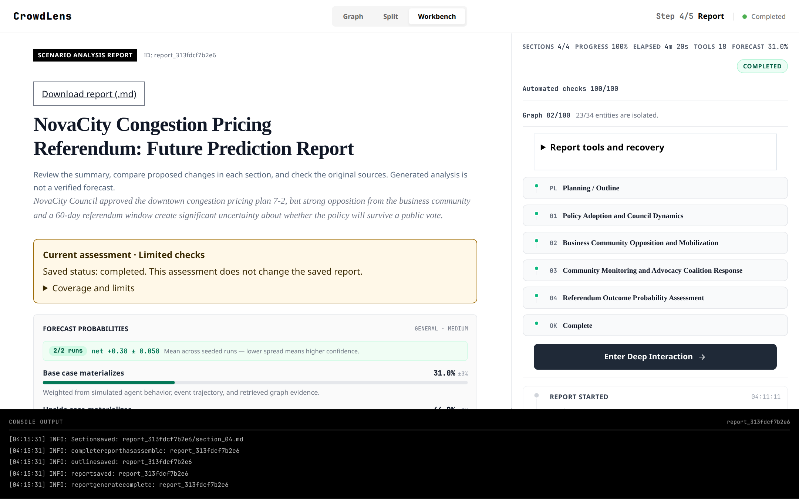
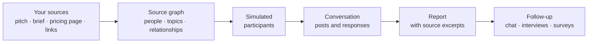
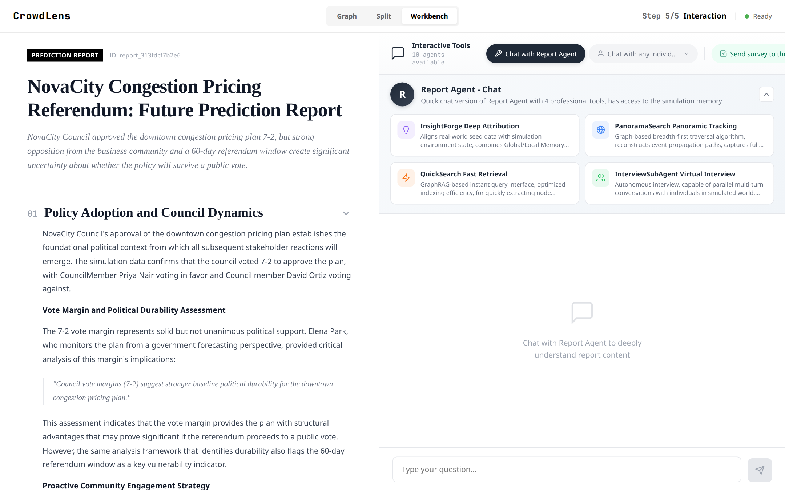

<div align="center">


# CrowdLens

### Test your idea on a simulated crowd before you take it to market.

Give CrowdLens your pitch, pricing page, or launch post. It builds a crowd of AI
participants from your own sources, lets them react, and shows you the
conversation and the evidence behind the analysis.

[](https://github.com/alinojoumi8/crowdlens/actions/workflows/ci.yml)
[](./LICENSE)


[Quick start](#quick-start) · [How it works](#how-it-works) · [What you can test](#what-you-can-test) · [Limits](#a-rehearsal-not-a-crystal-ball) · [Docs](#documentation)

</div>

<p align="center">
  
</p>
<p align="center"><sub>A report from a fictional city policy scenario. The same workflow runs on a product pitch, a pricing page, or a launch post. Generated analysis is not a verified forecast.</sub></p>

## Why CrowdLens

Most ideas meet their audience on launch day. By then the product is built, the
campaign is paid for, and the pricing page is public. If people react badly, you
learn it late and at full price.

CrowdLens moves that moment earlier. You describe your idea with the documents
you already have. CrowdLens reads them and maps the people and groups they
mention: customers, competitors, critics, partners. It turns them into simulated
participants and lets them talk. You watch where the conversation goes, read an
analysis that points back to your sources, and ask the participants your own
questions.

Then you change the idea and run it again. You see where your idea could go
before you commit to it.

| The usual way | With CrowdLens |
| --- | --- |
| You learn the objections after you launch. | You read simulated objections before you spend. |
| You get one launch and one result. | You change an assumption and run the scenario again. |
| Feedback comes from one person at a time. | Participants react to your idea and to each other. |
| An analysis asks you to trust it. | The report shows source excerpts, so you can check the claims. |

## What you can test

- **A new product idea.** Upload the pitch deck or the product brief. Explore which groups get interested, which groups push back, and what they ask first.
- **A pricing change.** Upload the pricing page and the announcement. Explore who accepts the change and who objects.
- **A launch message.** Run one announcement, then run another. Compare how the conversation moves.
- **A market entry.** Add market research and competitor pages as sources. Explore how buyers and incumbents might respond.
- **More than products.** The same workflow supports communication planning, policy scenario exploration, and research and storytelling.

## How it works



1. **Connect your sources.** Upload PDF, Markdown, or text files, or paste website links. Describe the scenario you want to explore. CrowdLens organizes the people, topics, and relationships into a source-linked knowledge graph.
2. **Set up participants.** CrowdLens creates simulated participants from that graph. You select who takes part and choose the scenario settings.
3. **Explore reactions.** Participants post and respond on a simulated public feed and a discussion community. You watch the activity and the run status.
4. **Review the report.** Read a structured analysis with excerpts from your original sources. For an analysis with no forecast percentages, choose the evidence-only report.
5. **Ask follow-up questions.** Chat with the report assistant, talk to one participant, or send a survey to the simulated crowd. Agent interviews require an available simulation environment.

A report is a draft that you can improve. **Draft with sources** proposes a
corrected section with a claim ledger and the original excerpts. **Save as new
revision** keeps your original report unchanged.

<details>
<summary>The full workflow, step by step</summary>

1. **Upload** — Provide PDF, Markdown, or text files and/or website URLs with a scenario requirement. CrowdLens stores source documents, creates project/case-version metadata, and generates an ontology.
2. **Graph** — Build entities, relationships, and source-linked chunks in Neo4j. Inspect graph progress and embedding readiness before continuing.
3. **Scenario** — Select entities and settings, generate agent profiles, and prepare the simulation configuration. Agent count and behavior depend on the sources and settings.
4. **Simulation** — Run agents on the selected simulated platform and inspect effective settings, unique posts, model actions and separately labelled initial/scheduled inputs. Run metadata and artifacts persist; file-backed agent memory and optional Neo4j memory updates do not guarantee complete history or lossless restart continuity.
5. **Report** — Generate a structured analysis with bounded original-source excerpts and actual simulation actions distinguished from graph/persona paraphrases and input posts. Choose **Evidence-only report (no forecast percentages)** before generation, or **Generate evidence-only report** in report tools, to analyze sources and hypothetical activity without numerical outcome forecasts. Otherwise new reports save provenance and freeze the forecast before prose so the headline table and panel share one authority. Inspect source evidence and review warnings; mechanical checks and report completion do not certify factual correctness.
6. **Proposal review** — On an eligible saved report, use **Draft with sources** to review a proposed section, summary changes, claim ledger, original excerpts and precise validation findings. Private diagnostics retain completion text and parsed model output. **Save as new revision** preserves the parent and creates a separate immutable report that remains `needs_review`.
7. **Saved human judgments** — Reopen a saved proposal and use **Record your review** to retain claim ratings, source references, notes, omissions and optional measured time. Review versions and disagreements survive reloads; export the frozen packet and labels using the existing rubric. [Review guide](docs/human-claim-review.md).

Report chat and agent interviews are optional follow-up tools. Agent interviews
require an available simulation environment. See the
[capability manifest](docs/product-capabilities.md) for API contracts, persistence
boundaries, current verification evidence, and remaining gaps.

</details>

<p align="center">
  
</p>
<p align="center"><sub>Step 5: ask the report assistant, one participant, or the whole simulated crowd.</sub></p>

## You stay in control

- **Local-first.** The default setup uses Ollama and Neo4j on your hardware. Hosted generation and embedding providers are optional; enabling them sends the corresponding inputs to the configured provider. Website ingestion and optional market lookups also require network access.
- **You set the limits.** Before generation starts, you authorize a maximum number of requests and minutes for the workflow. A request limit is not a monetary ceiling.
- **Open source.** CrowdLens is AGPL-3.0. You can read the code that produces your report.

## A rehearsal, not a crystal ball

CrowdLens is a place to rehearse. It does not predict the future.

- Simulated participants are AI models. They are not your real customers.
- Simulation output is generated behavior, not a verified forecast of real people or markets.
- Reports show their sources, but mechanical checks and report completion do not certify factual correctness. Review source attribution and factual claims before using a report to inform a decision.

Use CrowdLens to find the questions, objections, and blind spots early. Then
take them to real people.

## Quick Start

You need Docker and Docker Compose. For a manual install, see
[Setup and configuration](docs/setup.md).

The container serves the built frontend and API with Gunicorn. See the
[production release and rollback guide](docs/CI-AND-RELEASE-WORKFLOW.md) for
image verification, upload ownership, release gates and recovery.

```bash
git clone https://github.com/alinojoumi8/crowdlens.git crowdlens
cd crowdlens
cp .env.example .env

# Generate a password, then paste it into NEO4J_PASSWORD= in .env
openssl rand -hex 24

# For local Ollama in Docker, set these two values in .env:
# LLM_BASE_URL=http://ollama:11434/v1
# OPENAI_API_BASE_URL=http://ollama:11434/v1
# For MiniMax M3, use the hosted configuration in docs/setup.md instead.

# Start all services in CPU-compatible mode
CROWDLENS_BUILD_REVISION="$(git rev-parse HEAD)" docker compose up -d --build

# Pull the required models into Ollama
docker compose exec ollama ollama pull qwen2.5:32b
docker compose exec ollama ollama pull nomic-embed-text
```

Open `http://localhost:3000` — that's it.

All published ports bind to loopback. To opt into NVIDIA GPU acceleration,
start the same stack with the GPU override:

```bash
docker compose -f docker-compose.yml -f docker-compose.gpu.yml up -d
```

Local models need a capable machine. See the
[hardware requirements](docs/setup.md#hardware-requirements) for memory, VRAM,
and lighter model options.

## Documentation

- [Setup and configuration](docs/setup.md) — manual install, providers, architecture, hardware, development checks
- [Product capabilities, contracts, and verification gaps](docs/product-capabilities.md)
- [Architecture](docs/architecture.md)
- [Evidence-first report proposals and revisions](docs/evidence-first-reports.md)
- [Workflow request/time authorization and Stop contract](docs/workflow-execution.md)
- [Roadmap](ROADMAP.md)
- [Verification history](docs/verification-history.md)

<details>
<summary>All documentation</summary>

- [Report reliability tasks and fresh actual-provider acceptance](docs/audits/2026-10-03-report-reliability.md)
- [Completed corrective task checklist](docs/tasks/2026-10-03-report-reliability.md)

- [Control/recovery repairs and exact-candidate synthetic verification](docs/audits/2026-10-03-control-recovery.md)
- [Previous fictional live-run request accounting](docs/audits/2026-10-03-bike-lane-request-accounting.md)
- [Real MiniMax browser tests, saved revision, blocked drafts and remaining gaps](docs/audits/2026-10-03-live-cedarbrook.md)
- [Visible-browser acceptance plan and execution status](docs/visible-browser-acceptance.md)
- [Workflow request/time authorization and Stop contract](docs/workflow-execution.md)
- [Product capabilities, contracts, and verification gaps](docs/product-capabilities.md)
- [ECC workflow and adoption plan](docs/ECC-WORKFLOW-PLAN.md)
- [Local ECC execution handoff and exact-candidate verification](docs/audits/2026-10-02-ecc-milestones-3-5.md)
- [Synthetic evidence evaluations and pending human review](docs/evaluations/evidence-quality.md)
- [Browser QA, screenshots, and test substitutions](docs/audits/2026-10-02-milestone4-browser-qa.md)
- [Local release verification and operational gaps](docs/audits/2026-10-02-milestone5-release-verification.md)
- [Evidence-first report proposals and revisions](docs/evidence-first-reports.md)
- [Architecture](docs/architecture.md)
- [Storage migration, backup, and recovery](docs/control-plane-migration.md)
- [Coordinated cold backup and recovery](docs/coordinated-backup.md)
- [Coordinated restore verification](docs/audits/2026-10-10-coordinated-recovery.md)
- [Economic twin scenarios](docs/economic-twin-v1.md)
- [Jev evaluation and promotion boundaries](docs/jev-evaluation.md)
- [Roadmap](ROADMAP.md)
- [CrowdLens brand and rebrand plan](docs/rebranding.md)
- [Historical migration progress](docs/progress.md)

</details>

## License

AGPL-3.0. See [LICENSE](./LICENSE).

## Credits & Attribution

CrowdLens is a modified fork of the original work by [666ghj](https://github.com/666ghj), incorporating the local-runtime fork maintained by [nikmcfly](https://github.com/nikmcfly), originally supported by [Shanda Group](https://www.shanda.com/). The simulation engine is powered by [OASIS](https://github.com/camel-ai/oasis) from the CAMEL-AI team.

The product name has changed; existing storage paths and Docker service names remain compatible.
See [the rebrand plan and compatibility notes](docs/rebranding.md).

**Modifications in this fork:**
- Backend migrated from Zep Cloud to local Neo4j CE + Ollama
- Entire frontend translated from Chinese to English (20 files, 1,000+ strings)
- All Zep references replaced with Neo4j across the UI
- Rebranded the product to CrowdLens, with updated UI, visual assets, and documentation
- Preserved original author and contributor attribution and existing runtime identifiers
