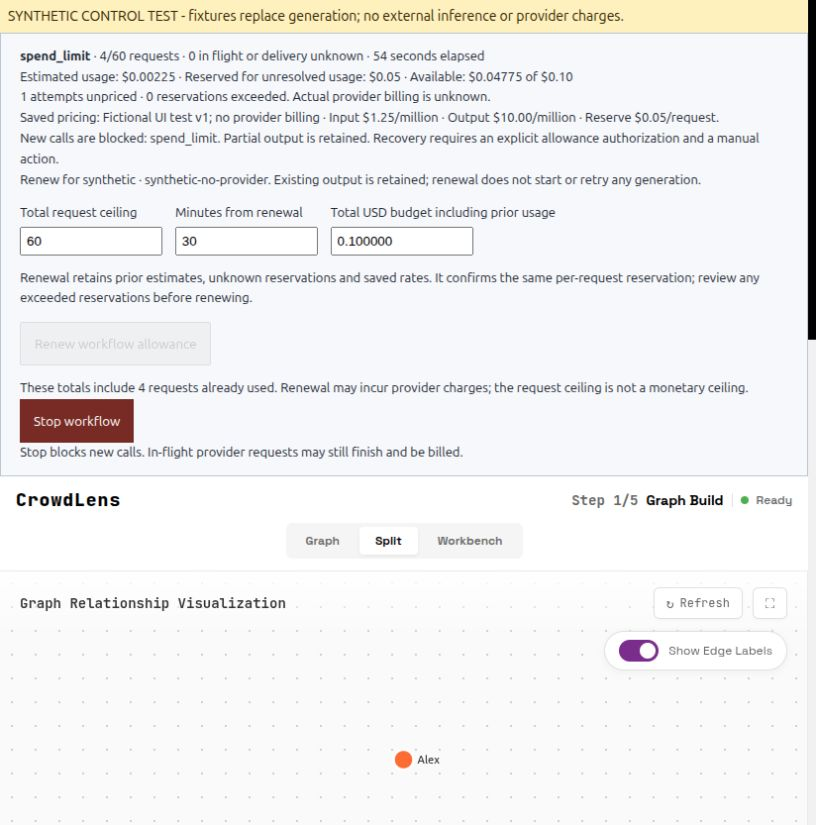
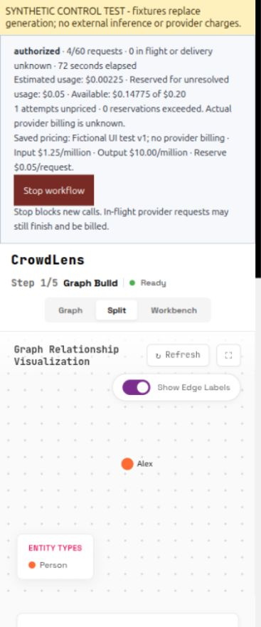

# Spending admission verification — 2026-10-11

The optional USD policy reserves money using explicit operator assumptions. It
never reports a provider invoice cap or substitutes a different model price.
[Contract](../workflow-execution.md#optional-usd-admission-policy-version-1).

Offline checks: 916 backend tests, 95 frontend tests (12 Node + 83 Vue), build.
New coverage includes separate-process budget contention, OpenAI and OASIS
transport retries, cache-token counting, malformed usage, unknown-reservation
retention, restart, late usage after Stop, settlement idempotency, overrun and
explicit renewal retaining all consumption. No paid calls were made.

The real built Vue UI and Flask/SQLite controls ran in the disposable
`smoke_ecc_browser.py` harness. A fictional text upload and prompt were authorized
with an explicit fictional rate card. Ontology/graph generation were substitutes,
not model or Neo4j validation. The fixture injected one delivery-unknown attempt
and one complete token receipt through the real ledger. Admission blocked at
four requests with USD 0.00225 estimated, USD 0.05 unresolved and USD 0.04775
available, too little for the USD 0.05 next reservation. Reload retained the
balance. Explicit renewal to USD 0.20 retained all four requests and prior costs;
no new request was started. The allowance region had no horizontal overflow at
375, 768 and 1440 pixels. The only browser console error was the harness's
unsupported readiness endpoint, not a spending-control failure.

[Blocked receipt](evidence/2026-10-11-spending/spending-blocked.json),
[browser source/assets identity](evidence/2026-10-11-spending/browser-identity.json).
The identity records the pre-commit parent plus a source fingerprint of the
working candidate; remote CI below must identify the committed candidate.

Remote CI, integration and deployment are pending. The hosted workflow and
independent human quality baseline are separate remaining work.
