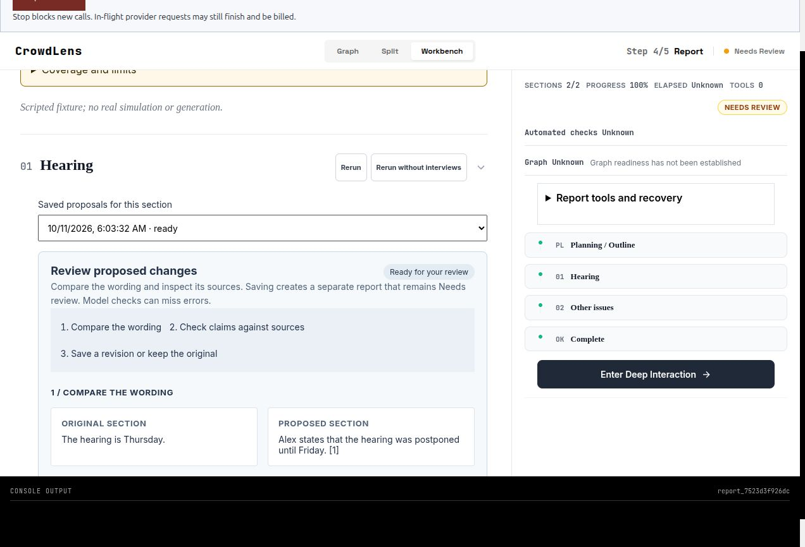
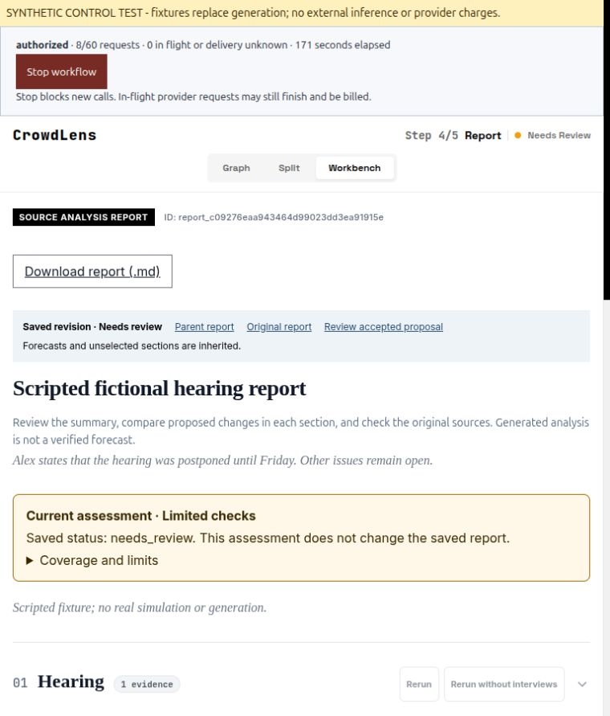

# Workflow verification and human review handoff — 2026-10-11

## Current offline workflow (T06)

The fresh browser journey uses the built frontend and real Flask/SQLite APIs
on application base `61a65f13e4358c081635b1fe73a81d6d4180c98c`, with the working
harness identified by its [source/assets identity](evidence/2026-10-11-workflow/identity.json).
The [verification receipt](evidence/2026-10-11-workflow/verification.json) records
source and download hashes, report/proposal/revision IDs and explicit substitutes.
No external provider requests were made.

| Boundary | Evidence and scope |
| --- | --- |
| PDF and text input | Real multipart upload, original bytes retained, parser and project/case association exercised in two automated HTTP flows. |
| Ontology and graph | Scripted generation and graph storage; actual project/task persistence and graph-build endpoint wiring. No Neo4j or semantic embedding proof here. |
| Preparation and simulation | Scripted endpoints/settings echo, one agent and two rounds. Browser starts from idle and requires explicit Start. This does not validate real persona/config generation or OASIS execution. |
| Root report | Scripted agent through the real asynchronous report endpoint, ownership and persistence; `needs_review` remains visible. |
| Source review | Real proposal creation, source review, immutable revision acceptance and export, with scripted drafting LLM. Automated flows verify all parent file hashes before/after and acceptance idempotency. |
| Browser | Source PDF visible; proposal ready; revision saved and reopened. No horizontal overflow at 375, 768 or 1440px. |
| Downloads | Actual downloaded review ZIP passes archive integrity and includes JSONL; downloaded Markdown contains the accepted Friday correction. Blank review assessment remains PENDING. |
| Admission ledger | All six stages counted through the real ledger. Zero token/cost estimates reflect scripted receipts only. Browser workflow explicitly stopped after completion at eight requests. |

Run the portable regression without built frontend assets:

```sh
backend/.venv/bin/python -m pytest backend/tests/test_offline_workflow.py -q
```

The full local check passed 918 backend and 95 frontend tests plus the production
build. The final small harness correction (idle before explicit Start and saved
settings echo) was followed by both targeted PDF/text tests passing again.
Remote CI verifies the committed candidate separately.





### Hosted canary still pending

A fictional Cedarbrook PDF/text canary has been prepared privately. The proposed
allowance is at most 60 physical requests and 30 minutes on the existing
MiniMax-M3.1-Flash-Preview plan, four agents, two public-feed rounds, memory off,
fast report and review/export. It can consume existing subscription credits and
is not a monetary cap. No new purchase or extension is included. The explicit
allowance question is pending; no hosted inference was performed. Offline
success cannot close this gate or establish factual/forecast quality.

## Human baseline handoff (T08)

The preserved 2026-10-03 historical actual-model collection was copied into a new
private handoff directory without modifying any of its nine files. Four packets
contain eight original fictional documents and 19 claims. Reviewer material
omits model identity, automated findings and administrator mapping; the operator
has seen the collection, so this is not a claim of complete operator blinding.
The historical model was MiniMax-M3, not the current M3.1 preview.

The current importer read the blank forms and returned PENDING, four pending
forms, zero review rows, null quality rates and null measured time. All human
fields remain unfilled. The browser shows original sources before candidate
text, a manual active-review timer and a local JSONL download. No AI ratings are
presented as human judgments. See the non-sensitive
[handoff receipt](evidence/2026-10-11-workflow/human-handoff-receipt.json).

The private handoff at `~/Documents/CrowdLens-reviews/2026-10-11-human-baseline/`
contains a README with exact import instructions, standalone reviewer HTML,
reviewer-only ZIP, packet hashes and separate administrator material. The
loopback review server serves only the reviewer folder. A human must save real
labels and active review time before the importer can calculate metrics;
collector verification, disagreements and adjudication remain explicit.
Independent human quality acceptance is still open. No holdout tuning or new
model generation was performed.
