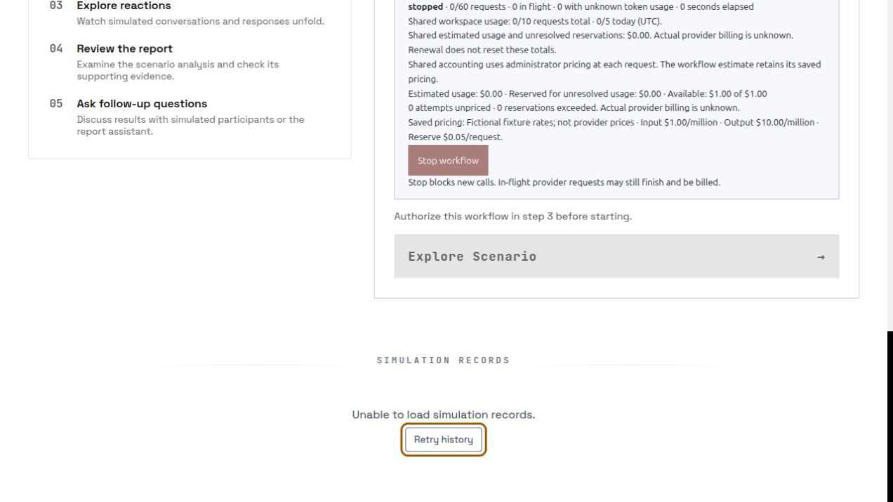
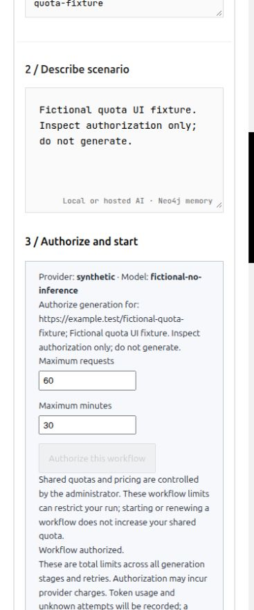
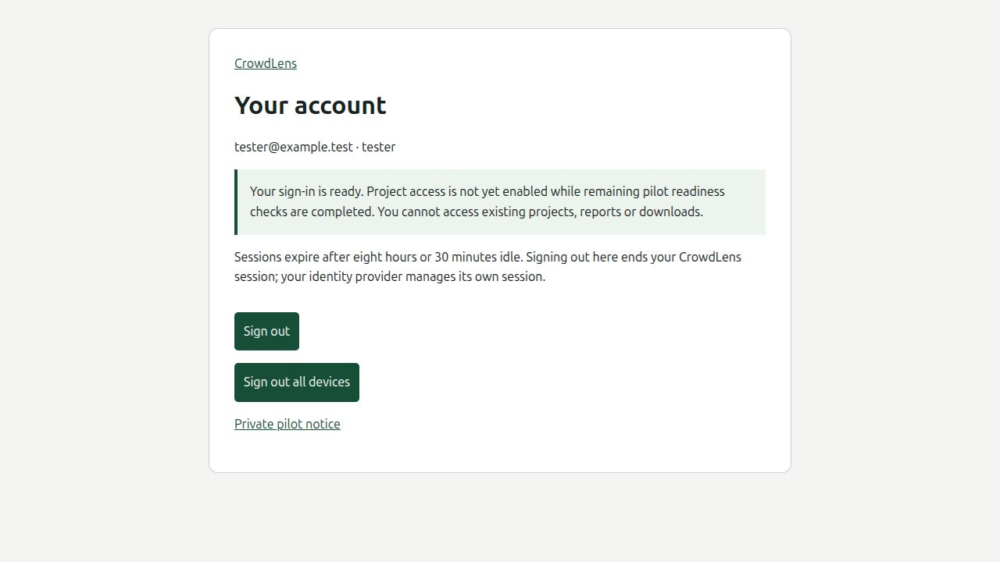

# B08 administrator-owned quotas — local verification

Date: October 21, 2026. Branch: `codex/administrator-quotas`, based on canonical
main `26397fbe612607adfa814ad20d44bd84c37f6a7f` (merged PR #35).

## Delivered behavior

OIDC installations require durable, administrator-configured global and private
workspace policies. Missing policies and zero limits deny admission. Tester
clients cannot set shared prices, reset counters or grant themselves allocations.
Administrator changes require the existing authenticated MFA session and CSRF
checks and are audited. The provider/model/endpoint identity is bound to pricing.

Physical model attempts and retries reserve requests and estimated cost in the
same transaction as workflow admission. Global and account ceilings survive new
workflows, Stop, renewal, midnight and process restart. Unknown attempts retain
their reservations. Complete usage settles once at the saved rates; an estimate
exceeding its reservation closes global admission. The global switch blocks new
work while Stop, deletion and late settlement remain possible.

Operation admission bounds workflow creation/renewal and expensive non-generation
requests. HTTP operations and background tasks share a cross-process active-work
fence. Pending work and orphan HTTP slots are not assumed complete after restart.
The administrator can record a provider-statement reconciliation without erasing
unknown reservations or resetting counters.

Managed storage writers check a cumulative logical byte allowance before
publication, preserving existing files on rejection. Atomic writers and logical
graph mutations participate. Fixed simulation children install file/descriptor
and SQLite write metering; stdout is charged through a bounded parent pipe.
Exhaustion stops the owned child; closing a completed idle environment preserves
the completed outcome. The server interpreter is not globally patched.

The workflow UI shows server-owned pricing and shared usage, distinguishes
estimates from unknown provider billing, disables the parent start action after
shared closure, and provides an actionable quota error.

## Verification

- The initial OIDC regression reproduced the missing-policy bypass: authorization
  returned 201 where the test required 429. The repaired acceptance suite passes
  all 43 cases, including real OS process races, renewals, UTC boundaries,
  per-account/global limits, unknown usage, pricing changes and restart retention.
- Final follow-up `UV_PYTHON=3.11 pnpm check`, with Node 22.23.4, passed 1,164 backend
  tests, 12 frontend unit tests, 119 component tests and the production build.
- Root and frontend dependency audits report zero vulnerabilities. Compose
  configuration and staged/working-tree whitespace checks pass. Lint and
  type-check scripts are not configured.
- Boundary tests exercise the real upload writer, concurrent file publication,
  restarted child interpreters, SQLite worker-thread writes, the installed OASIS
  schema initializer, stdout capture and completed-run preservation. Model and
  graph transports are synthetic; no external inference was used.
- Chromium inspected a disposable loopback fixture with fictional identities and
  rates: managed pricing notice, authorization, global closure, Stop, rejected
  renewal, disabled parent start action and a 375-pixel layout without horizontal
  overflow. The persisted shared request counter remained zero. This fixture is
  not the production runtime or a real identity-provider acceptance test.
- CodeRabbit's included allowance became available for the follow-up. Its full
  canonical-origin branch review completed with four major issues. Regressions
  reproduced the affected behavior before fixes: the UI granted start permission
  for a stopped/missing state without an admission flag; buffered chunk writes
  repeatedly encoded their entire history; admission halts stranded queued
  proposals; and progress polling consumed operation/active-work capacity.
- The UI now requires the explicit `authorized` state. File metering uses an
  incremental encoder and byte count, preserving newline/stateful encoding,
  rejection recovery and pre-publication checks. All three proposal admission
  paths clean up and rethrow control-flow halts. Registered proposal-detail,
  simulation-run, preparation and ensemble status polls are exempt from operation
  admission. Proposal-history listing and full action-detail enumeration remain
  metered intentionally; they are not the repeated cheap progress poll.
- The refreshed audit reported moderate advisories in the existing Vitest
  4.1.11 dependency family. Vitest and its matching internal packages are patched
  to 4.1.12, retaining the npm lockfile and audit gate. References:
  [manual mock registration](https://github.com/advisories/GHSA-qxg6-89mg-rqv8)
  and [Windows redirect traversal](https://github.com/advisories/GHSA-xp26-3454-mjgp).
  Lock generation used npm 11 in a disposable directory after npm 10's resolver
  crashed; the normal npm 10 clean install then passed with zero vulnerabilities.
- The first follow-up cleared the major issues and reported two minor issues.
  The tester notice now describes the remaining pilot-readiness gate. Empty
  summaries can receive a section review while remaining empty; non-text summaries
  return 400 before scheduling. Source review and nonempty-summary mapping guards
  remain required. Regression tests cover both findings through the API and
  accepted immutable revision. Empty UTF-16 publication also checks its encoding
  prefix before writing, preserving the byte allowance after the performance fix.
- Chromium verified the current built start action stays disabled after Stop even
  with an intentionally omitted admission flag in the disposable fixture. The
  persisted request counter remained zero. The updated tester account notice was
  inspected in the same fictional fixture. Images below contain no private data.
- The final CodeRabbit follow-up completed with zero issues across all 14 changed
  follow-up code/test/dependency/document files. The earlier completed branch
  reviews cover the unchanged B08 implementation. All application, dependency
  and test files match the reviewed snapshots. The final evidence wording and
  inspected screenshots received a focused documentation/visual review. No paid
  credits, overages or subscription changes were enabled.

## Remaining delivery and rollout gates

This audit records local verification. The PR and Atlassian delivery entries hold
the hosted CI and exact-candidate container build/smoke receipts. Local CodeRabbit
and configured checks passed; hosted checks remain a separate delivery gate.
No merge or deployment is part of this delivery task.

`storage_write_bytes` measures cumulative logical writes, not physical occupancy,
database/index overhead or an OS disk quota. Internal control metadata, bounded
cancellation repair, parser temporary files and host diagnostics have separate
capacity requirements. The child meter is not an arbitrary-code sandbox. These
tests do not establish autonomous OASIS behavior, provider invoice accuracy or a
general external-beta acceptance.

Tester project access remains gated. Next application work is B09 external
file/URL/generated-output hardening, followed by the applicable hosting,
networking, B12 execution/capacity, restore and combined acceptance gates. Retain
the local/private fictional-data scope and one-worker runtime. Actual provider
rates, real IdP MFA/recovery and any future live-model test require their own
verified configuration and authorization.

The Confluence backlog and runbook were first checked through the signed-in
browser after connector timeouts; refreshed connector reads succeeded for the
PR-opening follow-up. The unfinished Jira query
`statusCategory != Done AND (text ~ "CrowdLens" OR text ~ "MiroFish")` returned no
matches; Confluence still contains unfinished work. The delivery update must
retain the actual review/hosted verification status and tester-access gates.
