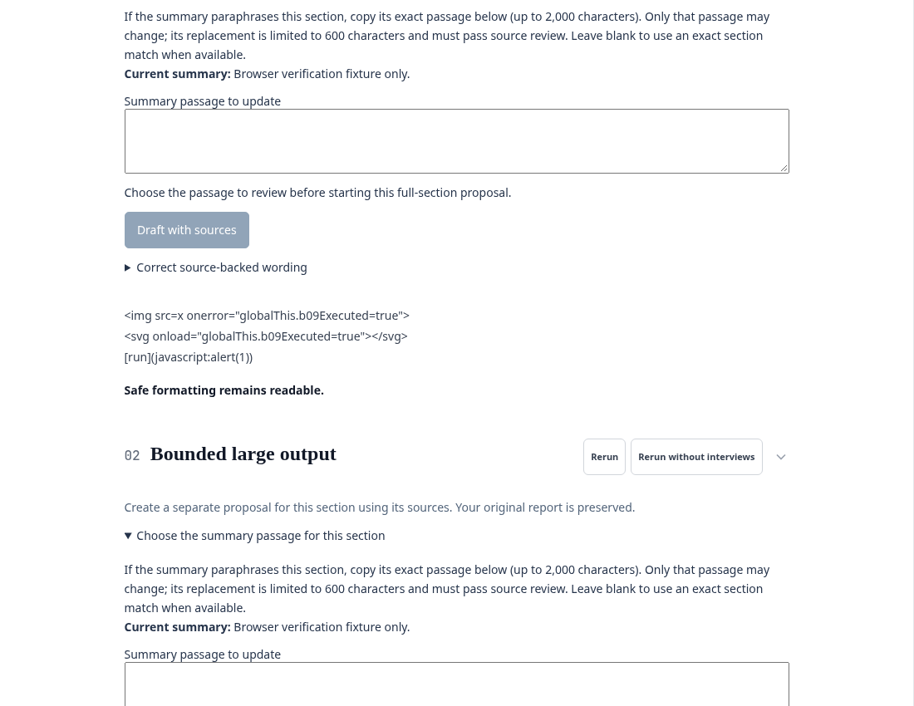
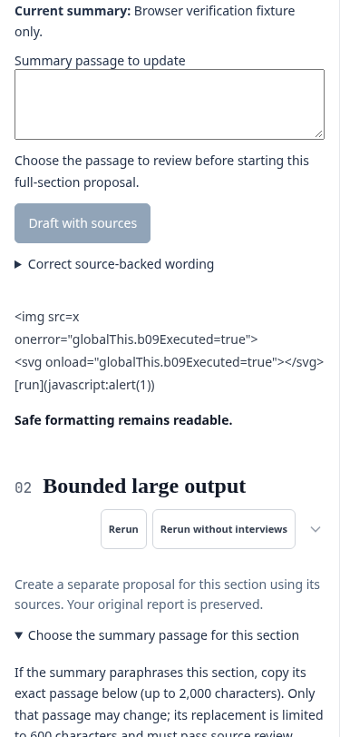

# B09 local implementation and verification

On October 21, 2026, implemented B09 on `codex/input-output-hardening`, based on
merged main `dea7ea4cd554a08d9175ce2ad315698bf25e2d60`. The application/test change is
commit `b6f299d7c5bf56e079f57e2ef3d32bdd75f868f9`. This is local delivery evidence;
no B09 PR, hosted CI, merge or deployment has occurred.

## Result

Uploads validate supported types and binary/PDF signatures, enforce byte/source
counts and reject a whole invalid batch before model work or case-version
publication. File and URL extraction run in disposable processes with CPU,
virtual-memory, wall-time, output, page, text and OCR limits. Failed new projects
are cleaned up; case creation waits for valid sources. Existing cases survive a
rejected document batch.

HTTP connections pin validated public addresses, preserve HTTPS hostname and CA
verification, and revalidate redirects. Credentials, environment proxies,
nonstandard ports, private/metadata/translated addresses, compressed or oversized
responses and partial/stalled bodies fail closed. Declared text encodings are
preserved with bounded fallback detection.

Browser output stays escaped and display work is bounded. Security headers cover
pages, APIs, errors and attachment downloads; OIDC APIs remain same-origin. Remote
font requests are removed. Generated tool calls cannot choose destinations or
scope. Generated Neo4j labels are validated before cache/write/embedding and
lookups use parameters. Invalid older cache entries can recover through a valid
retry under the existing allowance.

Limits and operating behavior are in [the ingestion guide](../ingestion-hardening.md).
In particular, the pilot permits at most one scanned page per source, preflighted
before any OCR. It permits 3,000 text-PDF pages, subject to character/resource
limits. Sources beyond the envelope must be split explicitly; no partial result
is represented as a complete source.

## Verified

- Final `UV_PYTHON=3.11 pnpm check`: **1,220 backend tests**, **12 frontend unit
  tests**, **128 component tests**, and production build passed. The backend count
  includes **56 new hostile-input/recovery cases**. Existing OCR, source review,
  two-user ownership and administrator quota regressions remain green.
- Root/frontend dependency audits: zero vulnerabilities. Compose configuration,
  whitespace checks and the scoped commit secret scan passed. Lint/typecheck
  scripts remain unconfigured; no such check is claimed.
- CodeRabbit CLI 0.9.1 reviewed the full change and two follow-ups in an isolated
  clone with canonical CrowdLens origin. Three major and two minor issues were
  verified and fixed: CA trust, OCR capacity policy, HTML encoding, rejected-case
  cleanup and invalid-label cache recovery. The final follow-up raised **0 issues**.
  All 21 application/test/guide files byte-match the applicable reviewed snapshots.
  No paid credits, overages or review-trigger comments were used.
- Chromium inspected the built report view with fictional stored HTML, SVG,
  JavaScript-link and overlong text payloads. No active payload elements or script
  execution appeared; the display-limit notice was present. No remote resources
  loaded. The 375-pixel viewport had no horizontal page overflow. Screenshots below
  are fixture evidence, not real-source or model-quality acceptance.
- Real local Tesseract recovered one fictional scanned page through the worker in
  **0.669 seconds** on this host. This measures that fixture, not all OCR workloads.
- The production image built, then passed the offline non-root startup, control
  storage, graceful-shutdown and restart/persistence smoke. Declared revision is
  `b6f299d7c5bf56e079f57e2ef3d32bdd75f868f9` at both starts; source fingerprint
  `a9a21276ac64f2f503e3e32e6e329aca42ae7e6f7f6c4f020b58212576b4e4f7`
  matches local source. A separate network-disabled image probe verified real
  worker PDF extraction, binary rejection, metadata-URL rejection and CA presence
  as UID 1000. Image ID:
  `sha256:7f4eb3f084b341f7089dc012b2669ff825a630bf5e2216a3f54ae3b482b608b4`.
- A disposable, network-disabled Neo4j 5.18 instance returned one owned-row match
  for a valid label and zero matches for an injection-shaped label. Both fixture
  nodes remained. Earlier startup attempts needed an explicit loopback hostname;
  the final successful probe used no existing database or published port.
- Verification used fictional data and mocked providers. No model calls,
  allowance renewal, deployment or new paid services occurred. Unrelated local
  AGENTS/roadmap/acceptance documents were preserved.

Private logs and machine-readable receipts are retained at
`/home/ali/.local/state/crowdlens/b09-20261021/`.

## Limits and next delivery

Workers provide process/resource separation, **not a complete native-parser
exploit or filesystem sandbox**. Logical-write quotas do not measure physical
disk occupancy. No malware certification, semantic prompt-injection immunity,
external-host networking acceptance or factual-quality claim is made. Linux
worker limits fail closed on unsupported environments. Keep tester access gated,
one app worker and the private fictional-data policy; B11/B12/B23 and combined
acceptance remain separate gates.

Next: open the focused B09 PR and run hosted CI, then obtain merge authorization
and verify post-merge CI. The next application area is B10 clean private staging
with HTTPS within the existing local/no-new-paid-services scope, followed by B11
observed network and secret hardening. Atlassian remains the delivery tracker;
absence of matching unfinished Jira issues does not close the Confluence backlog.
