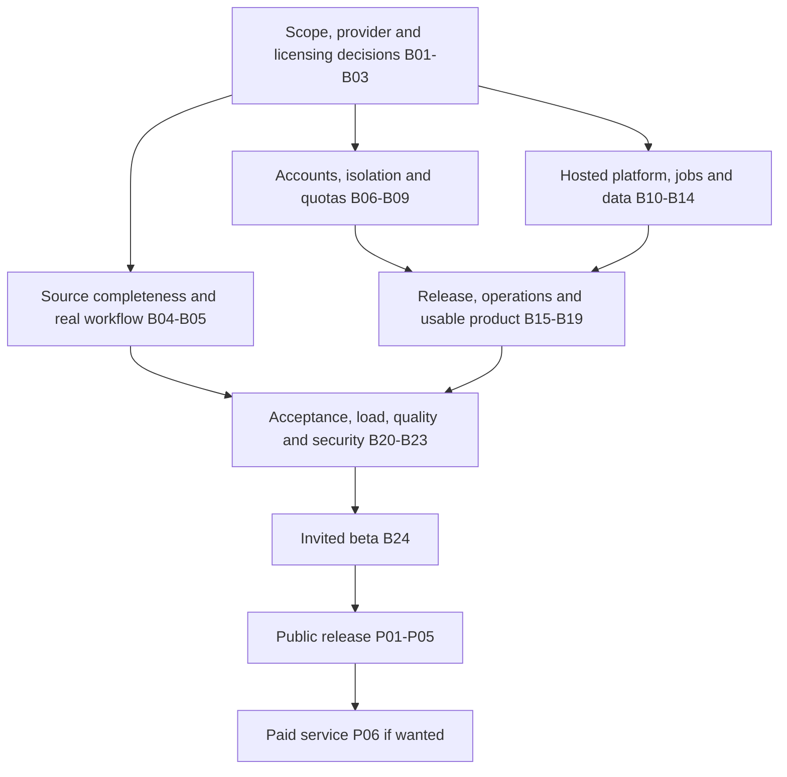

# CrowdLens: roadmap to external testing and production

> Historical planning snapshot, preserved on October 29, 2026. Baselines, PR states, backlog statuses and implementation order below describe the October 14 assessment. Later work is recorded in the [October 18 acceptance closeout](../audits/2026-10-18-beta-acceptance-closeout.md) and subsequent dated [audits](../audits/). Use the [current delivery backlog](https://alinojoumi8.atlassian.net/wiki/spaces/CROWDLENS/pages/590020) for current status and remaining acceptance gates. Retaining this plan does not reapprove provider runs or external invitations.

Assessment: **October 14, 2026, America/Toronto**. This is a delivery plan, not a production-readiness certificate. Planning IDs below are local references, not Jira issue keys.

**Recommendation: release to 5–10 invited testers first, with private workspaces, capped free usage, a dedicated hosted environment and a narrow supported workflow. Expand to public signup after the pilot demonstrates reliable operation.** The cohort size and release scope are proposed defaults; the audience question was still unanswered when this plan was prepared.

The app has a substantial working core and production-serving machinery. The largest remaining change is the move from a trusted local operator to multiple independent users. A login screen alone will not provide that boundary: ownership, permissions, spending, background jobs, storage and downloads must all follow the authenticated workspace.

## 1. Evidence and present state

The source baseline is canonical private repository `alinojoumi8/crowdlens`, commit `0d1ba7624ae3fec89995938fd1b9081a73295b88`. Local HEAD, remote main and the running app's declared revision agreed during inspection. `/health` and `/api/status` returned source fingerprint `7cafe2a4b3d3ab5d07f2f5e6d144a1b45b7e98d39c720f143ba392d43e648ff5`. [Exact-main CI passed](https://github.com/alinojoumi8/crowdlens/actions/runs/38520097884).

Source-completeness implementation advanced separately during this review, on `codex/source-completeness`, and was left untouched. At handoff, local HEAD was `24d45fb` in open [PR #29](https://github.com/alinojoumi8/crowdlens/pull/29); canonical main still remained `0d1ba76`. This assessment describes the released baseline and treats PR #29 as **in progress, pending confirmation of its own review, CI, merge and deployment**. Refresh this snapshot before executing the plan.

| Area | What exists | What remains |
| --- | --- | --- |
| Core workflow | Document/URL ingestion, graph construction, participant setup, simulation, reports, proposals, revisions and downloads. | A successful current-release acceptance journey with actual autonomous activity and truthful handling of incomplete evidence. |
| Deployment | Built Vue assets, non-root Gunicorn image, frozen Python dependencies, candidate CI and offline image smoke. | A dedicated externally accessible environment, TLS, deployment governance and external-client verification. |
| Accounts and access | Local CORS and explicit workflow execution allowances. | Application user authentication, role checks and workspace ownership. `list_projects()` lists global projects; execution authorization is spending permission for the local operator, not user identity. |
| Costs | Durable request/time limits, optional USD reservations, unknown-usage retention, Stop and explicit renewal. | Administrator-owned account/workspace/global quotas. A tester must not be able to create or renew arbitrary allowances against the shared provider key. Estimates do not guarantee the invoice. |
| Jobs | Persisted task ownership, leases, process identity checks and restart reconciliation. | Global workload admission, capacity measurements and a user-facing busy/queue contract. Runtime intentionally requires one Gunicorn worker. |
| Evidence integrity | Immutable revisions, exact source links, saved reviews, summary-scope guards and activity provenance. | Supplied-document and passage completeness. Existing structural reproductions can omit later material or an empty extracted document while producing a ready proposal. |
| Recovery | Coordinated cold backup tooling, synthetic restoration, corrupt optional-memory preservation and scoped deletion. | Scheduled off-host backups, measured restore objectives, actual hosted-target restoration and a complete account/workspace deletion process. |
| Health | Live database/graph/storage checks passed; embedding model metadata was reachable. | Generation is `unverified` because model metadata is unsupported. This is neither a current inference success nor proof of an outage. |
| Network | App ports 3000/5001 are loopback-only. Repository Compose also specifies loopback dependency ports. | Running Neo4j 7474/7687 and Ollama 11434 were published on all IPv4/IPv6 host interfaces; running Ollama used `latest`. Reconcile actual deployment with the intended private, pinned configuration. Internet reachability was not tested. |
| User experience | Working local homepage, workflow controls, readiness, history, review UI and responsive checks from prior work. | Tester onboarding, safe presets, account lifecycle, clear hosted copy, help, feedback and support. Current home still says “Runs on your hardware” and exposes operator-level model/request controls. |
| Quality evidence | Prior source-first AI reviews and regression fixtures; saved human-review capability exists. | Current representative acceptance evidence and product-specific quality targets. The October 13 AI-review substitution is respected: no human ratings or validated forecast performance are claimed. |

The October 13 hosted canary completed ingestion, graph, preparation and reporting, but operational acceptance failed: one requested participant was missing, no autonomous reactions occurred, and revision acceptance was blocked. Subsequent participant, activity, lifecycle and summary-scope fixes are merged and deployed. Their offline tests and CI do not replace the still-pending hosted rerun. Latest [Confluence backlog, inspected at version 30](https://alinojoumi8.atlassian.net/wiki/spaces/CROWDLENS/pages/590020) supersedes older pending-authorization statements in repository planning documents.

Assessment method: code graph and targeted source inspection; repository/configuration/document review; current GitHub CI, Confluence and Docker state; non-generation health/status checks; and read-only inspection of the built homepage. No new model generation, destructive tests, host changes, application test-suite run or public deployment occurred during this assessment. Historical test counts remain attributed to their receipts.

## 2. Release boundaries

| Release | Audience and scope | Required evidence |
| --- | --- | --- |
| Supervised demonstration, optional | Operator runs a clean isolated instance containing only approved fictional fixtures; visitors observe or review designated results. | No access to existing private documents, authenticated entry, fixed resource limits and honest output labels. This is an early learning opportunity, not a private-workspace service. |
| Invited beta, recommended first target | 5–10 invited people; one owner per private workspace; free capped usage; supported PDF/MD/TXT and optionally verified URL input; one documented scenario workflow. | B01–B24 below, allowing an explicitly disabled feature to replace an unimplemented optional surface. Each advertised flow must pass. |
| Public release | Public signup within a published capacity and support envelope. | Beta exit evidence plus P01, P04 and P05; P02/P03 when capacity or availability requirements demand them. |
| Paid release, conditional | Users purchase access or usage. | Public-release gates plus P06 and measured unit economics. Charging users is not required to learn from the beta. |

Start with public or fictional source material. Permit confidential user uploads only after the access, retention, provider-handling and privacy gates cover those data types. Keep the current MiniMax model preference; any provider/model change must be explicit and validated.

Proposed beta architecture: one dedicated host, one app worker, bounded background work, persistent SQLite/artifact storage, private Neo4j and private local embeddings, behind an HTTPS ingress. Keep embeddings on the supported local Ollama path initially: the current execution contract rejects remote embeddings without a separate accounting design. SQLite can remain for a measured single-host beta; selecting PostgreSQL, external workers or object storage is a capacity/availability decision, not an automatic prerequisite.

## 3. Dependency map

The diagram groups workstreams; item-level prerequisites below are authoritative. Independent implementation can overlap, but final acceptance uses one immutable candidate containing all enabled features.

Priority: **P0** protects access, data, spending or truthful core behavior; **P1** makes the first external testing release usable and operable; **P2** expands the service after the beta. Every enabled beta item needs closure, even when its priority is P1. Owners are roles to assign, not people already committed.

## 4. Invited-beta backlog

### B01 — Fix the beta scope and success contract

**P0 · Product owner · New · Depends: none · Size: small**

Choose the first target user and task, invitation count, allowed source types/data sensitivity, supported browsers, report modes and limits on file/page count, participants, rounds, run time and concurrency. Define what a useful result means. Proposed starting scope is scenario exploration and evidence review, with generated behavior clearly labelled; defer claims of calibrated prediction.

**Done when:** a one-page beta contract lists enabled/disabled features, support hours, expected waiting behavior, numeric resource limits and release/rollback criteria. Select a hosting region and monthly infrastructure/provider budget. Limits are initially conservative and revised only from measurements.

### B02 — Confirm a provider account suitable for the hosted service

**P0 · Product owner + backend · Needs verification · Depends: B01 · Size: small, external dependency**

Verify exact account/model access, permitted application use, concurrent-request limits, quota exhaustion behavior, price basis, data handling, preview-model change/deprecation policy and operational support. MiniMax's current documentation lists `MiniMax-M3.1-Flash-Preview` as M Plan/Code-only; that does not establish this account's permission or capacity to serve a multi-user product. Retain the configured model until an explicit alternative is chosen. [MiniMax model documentation](https://platform.minimax.io/docs/api-reference/text-chat-openai).

**Done when:** the chosen account and exact model have a recorded deployment decision, capacity and pricing assumptions, credentials isolated by environment, and a failure policy. No silent fallback to a different model or a paid embedding provider. Provider configuration changes trigger a new canary, not automatic resumption of existing work.

### B03 — Resolve privacy, acceptable use and licensing for external users

**P0 · Product owner + qualified reviewer where needed · New · Depends: B01–B02 · Size: medium**

Document what is uploaded, where it is processed/stored, which providers receive it, retention/deletion, operator access, telemetry and support contact. Prepare the beta notice, terms and acceptable-use policy; avoid unsupported accuracy promises. Inventory application and dependency licenses, notices and source-access obligations, including the modified AGPL application and PDF tooling. A private GitHub link must not be assumed to satisfy required source access. [AGPL text, including section 13](https://spdx.org/licenses/AGPL-3.0-only.html).

**Done when:** the owner adopts an appropriate distribution/privacy approach, users can read the notices before uploading, required notices/source delivery work for intended recipients, and the actual infrastructure/provider behavior matches the written promises. This ticket is a review task, not a legal-compliance certification.

### B04 — Finish source completeness without weakening evidence guards

**P0 · Backend + frontend · Implementation in open PR #29; release gates pending verification · Depends: none · Size: medium/large for the workstream, not remaining effort**

Retain expected, admitted, empty, rejected and failed document inventory; track per-document chunks and covered intervals; disclose clipping and retrieval bounds. Prevent a full-document/full-corpus claim or unrestricted acceptance when required source coverage is unresolved. Keep citations, qualifiers, adverse evidence, original reports and accepted revisions intact. Include omissions of later stakeholders, differently scoped counts, empty extraction, more than 30 documents and reconstructed PDF windows.

**Done when:** the October 14 reproductions become meaningful regressions; API, UI, downloads and acceptance agree about the coverage boundary; independent code review, exact-candidate/main CI and preserved-data deployment pass. Existing frozen cases remain regressions, not fresh quality measurements. Coordinate with the active implementation instead of duplicating it.

### B05 — Prove the advertised workflow with an actual hosted canary

**P0 · QA + backend · Verification pending after deployed fixes · Depends: B01–B04, B08, B10–B12 · Size: medium**

Use approved fictional data and a fresh bounded allowance on the selected candidate. Verify exact named participants, real autonomous actions with transport/action receipts, retained completion after Stop, source review, accepted revision where evidence supports it, safe blocked paths, reopen and downloads. Deterministic smoke activation must remain visibly labelled and is not evidence of realistic simulation behavior. Add a representative normal-mode run if normal-mode activity is advertised.

**Done when:** one retained end-to-end receipt identifies source hashes, build/model, each stage as real or substituted, requests/retries/time/usage, outcomes and preserved originals. Happy path and expected refusal both behave as specified; no fabricated activity or relaxed guards to obtain a green result. A new run requires its own explicit provider/input/budget allowance.

### B06 — Add identity, invitations and account lifecycle

**P0 · Backend + frontend · New · Depends: B01, B03 · Size: large**

Integrate a maintained authentication solution. Support invites, sign-in/out, expired/reused invitations, account recovery, session expiry/revocation and account suspension. Add admin versus tester roles, administrator MFA and reliable transactional delivery for whichever email-based flows are selected. Use secure cookie/session settings and CSRF protection appropriate to the chosen flow; enforce identity in the API.

**Done when:** anonymous users cannot access protected APIs or downloads; expired/revoked sessions fail; a tester cannot invite users or perform admin actions; account recovery is tested from a second browser. No password handling or session security is improvised in the frontend.

### B07 — Enforce workspace ownership through every store and operation

**P0 · Backend/data · New · Depends: B06 · Size: large**

Bind projects, cases/versions, documents, graph nodes/edges/chunks, simulations, tasks, reports/revisions, proposals, reviews, caches, workflow allowances and exports to a server-resolved workspace. Carry that context into background jobs. Enforce authorization on lists, reads, mutations, source lookup, downloads, Stop/renewal and cleanup. Plan an explicit owner assignment for legacy data; ambiguous old data stays inaccessible. Prefer a clean beta dataset over copying existing private material.

**Done when:** two-user adversarial tests cannot read, infer, overwrite, stop, renew, delete or retrieve each other's resources by changing IDs or using search/graph endpoints. Admin access is intentional and auditable. Restore and migration preserve ownership. Authorization must be checked per request and object, including files. [OWASP authorization guidance](https://cheatsheetseries.owasp.org/cheatsheets/Authorization_Cheat_Sheet.html).

### B08 — Make spending and usage limits administrator-owned

**P0 · Backend · Existing ledger; multi-user extension needed · Depends: B02, B07 · Size: medium/large**

Keep existing durable reservations, retries, cancellation and unknown-usage accounting. Add server-owned per-user/workspace, daily/account-wide and global limits; prevent self-issued unlimited allowances and price manipulation. Apply limits to every billable path and expensive non-generation operation, plus storage and maximum active work. Provide a global admission kill switch and admin-only quota changes.

**Done when:** concurrent users, multiple new workflows, retries, restarts and renewals cannot reset or bypass the shared limits. 429/busy/limit responses explain the next action. Unknown in-flight use remains reserved; emergency closure blocks new calls. Display estimates separately from provider billing and reconcile account usage periodically.

### B09 — Harden externally supplied files, URLs and generated output

**P0 · Backend/security · Existing controls to extend and verify · Depends: B06–B08 · Size: medium**

Retain escaped Markdown, safe paths and URL redirect validation. Add/test file signature/type validation, per-file/per-account limits, extraction CPU/memory/page/text limits, parser timeout/isolation, safe download headers and an appropriate malicious-file handling strategy. Test URL schemes, redirects, DNS changes, cloud metadata/private network destinations and response bounds from the actual host. Treat source/model instructions as data; restrict tool actions and destinations server-side. Include security headers and same-origin/session policy.

**Done when:** malformed/oversized/hostile files, hostile source instructions, stored script content and prohibited URLs fail safely without disclosure, unbounded work or provider spend. If URL ingestion or a file type cannot meet the gate, disable it and remove its promise from beta UI. Current 50 MB upload limit is a starting control, not a complete parser defense. [OWASP file-upload guidance](https://cheatsheetseries.owasp.org/cheatsheets/File_Upload_Cheat_Sheet.html).

### B10 — Provision clean staging and beta hosting with HTTPS

**P0 · Operations · New · Depends: B01–B03 · Size: medium**

Choose the target, region and resource envelope; create reproducible staging/beta configuration, separate credentials/data, domain/DNS, TLS renewal, reverse proxy, persistent mounts and bounded service resources. Deploy a pinned app image by digest. Keep the development desktop and private historical data out of the hosted environment. Do not place this subprocess/filesystem-based app on ephemeral request-only hosting without redesigning those dependencies.

**Done when:** a second machine can use the intended HTTPS URL, invalid routes and certificate renewal are checked, staging cannot read beta data, and a fresh host can be built from the runbook without undocumented manual state. The deployed revision, source fingerprint and digest match the release record.

### B11 — Reconcile networking, secrets and dependency versions

**P0 · Operations · Confirmed runtime/configuration mismatch · Depends: B10 · Size: small/medium**

Expose only the intended HTTPS ingress; keep Neo4j, Ollama and backend management surfaces private. Reconcile the currently observed all-interface dependency bindings and unpinned running Ollama image through a coordinated host change. Verify shared consumers before touching existing services. Use least-privilege service credentials, protected environment/secret storage, rotation and redacted diagnostics; return minimal public health information.

**Done when:** observed listeners/firewall/container mappings match the plan and an external client cannot reach databases/model/admin ports. Secrets are absent from built assets, error responses and logs. Test rotation and provider access after it. Docker port publication can expose a service beyond its host; configured Compose defaults do not prove running network state. [Docker port-publishing documentation](https://docs.docker.com/engine/network/port-publishing/).

### B12 — Bound background execution and make waiting/recovery explicit

**P0 · Backend/operations · Existing ownership; capacity policy missing · Depends: B07–B08, B10 · Size: medium**

Add global admission for expensive jobs, per-workspace fairness, CPU/RAM/time bounds and a documented queue or explicit busy/retry response. Retain idempotency, owner leases and publication fences. Test browser closure, disconnect, worker death, app restart and shutdown during work. Preserve partial artifacts and require explicit authorized retry where continuation is unsupported.

**Done when:** overload cannot start unbounded subprocesses; users see queued/running/interrupted states accurately; cancellation reaches only the owned task; restart causes no duplicate spend/publication. Keep one app worker for the beta. Adding Gunicorn workers or replicas without externalizing ownership is unsupported by the current runtime.

### B13 — Schedule off-host backups and prove restoration

**P0 · Operations · Cold tooling exists; hosted operation pending · Depends: B07, B10–B12 · Size: medium**

Automate coordinated quiescence/cold snapshots of SQLite, artifacts, hidden proposal/review stores, graph state and required configuration. Encrypt and retain off-host copies with failure alerts, key custody and explicit retention. Rehearse restoration into a fresh isolated target, including ownership and deletion records. Keep a compatible rollback image and migration procedure.

**Done when:** a timed restore proves source/report/revision hashes, graph links, account isolation and honest interrupted-job states. Proposed pilot objectives: at most 24 hours of recoverable-data loss and restoration within 4 hours; adopt only after measurement. Cold backup requires an announced pause; it is not an atomic online backup or lossless simulation continuation guarantee.

### B14 — Deliver account/workspace export and deletion

**P0 · Backend + operations · Narrow project deletion exists · Depends: B03, B07, B12–B13 · Size: medium/large**

Implement or document an operator-assisted, tracked lifecycle covering originals, extracted text, graph/source chunks, memories, embeddings, simulations, logs, reports/revisions, reviews, proposals, caches, credentials and exports. Define which audit/billing records remain, for how long and why. Stop/fence writers first; make retries idempotent and expose progress/failure. Define backup expiry and how a restore avoids resurrecting previously deleted accounts/data.

**Done when:** an isolated two-workspace rehearsal exports/deletes only the selected scope, verifies retained-store rules and survives partial failure. User-facing deletion wording matches reality. Current project deletion deliberately retains many related stores and must not be presented as complete case/account erasure.

### B15 — Turn existing CI into a hosted release procedure

**P1 · Engineering/operations · Strong baseline; hosted gate pending · Depends: B10–B14 · Size: medium**

Keep exact-commit backend/frontend/image checks and immutable release identity. Add appropriate Python/container/secret scanning, authentication/isolation integration checks and built-browser smoke. Verify branch/ruleset enforcement and staging-to-beta promotion; do not infer protection from green CI. Validate schema migrations on copied data and rehearse a state-compatible rollback.

**Done when:** a release record contains commit, image digest, configuration version, test receipts, backup/restore evidence, migration/rollback steps and post-deploy results. Failed security/isolation/migration checks stop promotion. Dependency updates have an owner and cadence. Supply-chain attestation/SBOM depth can increase for public release.

### B16 — Add operational visibility and an incident playbook

**P1 · Operations + backend · Request IDs exist; operational coverage pending · Depends: B08, B10–B13 · Size: medium**

Collect redacted structured errors and request/task correlation. Track workflow failures/stalls, latency, queue depth, process count, CPU/RAM/disk/inodes, database/embedding availability, provider quota/429s, usage estimates and backup freshness. Separate process liveness, dependency readiness and a dated authorized generation canary. Put infrastructure details behind admin access.

**Done when:** synthetic app failure, stuck worker, low disk, backup failure and provider quota exhaustion generate actionable alerts to a named operator. The playbook covers stopping admission, disabling an account, pausing uploads, preserving evidence, restoring service and communicating an incident. Logs omit uploaded text/prompts/secrets by default and have explicit retention.

### B17 — Make first use understandable without an engineer

**P1 · Product/frontend · Existing local flow needs hosted adaptation · Depends: B01, B06, B08 · Size: medium**

Add a fictional sample scenario, a short quick-start and safe preset limits. Explain upload support, input rejection, processing stages, likely waits, remaining allowance and how to stop/retry. Replace local-only marketing text when hosted. Keep provider keys, internal endpoints and editable rate assumptions in admin settings; show testers the choices that affect their run.

**Done when:** a new tester can sign in, start the sample, understand progress and find the report without terminal commands or operator explanation. Test empty, loading, failure, out-of-quota and provider-unavailable states. Onboarding never silently starts billable work.

### B18 — Finish the report/review and export experience

**P1 · Product/frontend · Existing review flow; release polish pending · Depends: B04–B05, B07, B17 · Size: medium**

Present source coverage, omitted/failed inputs, actual versus seeded activity, smoke-mode disclosure and AI-review provenance in understandable terms. Distinguish complete processing from a useful simulation and from factual correctness. Make original/accepted revision/history/downloads easy to locate, and explain blocked proposals with a supported next step. Restrict unsupported advanced flows behind feature flags.

**Done when:** reload/back navigation and export retain the same report mode, source boundaries, original/revision identity and warnings. Empty activity cannot look like a completed discussion. Any numerical forecasts remain explicitly experimental unless separately validated. UI and downloaded artifacts make the same claims.

### B19 — Give testers a feedback and support channel

**P1 · Product/frontend/operations · New · Depends: B03, B06, B16–B18 · Size: small/medium**

Add bug feedback linked to a redacted run ID/build, a support contact, known-issues page and triage process. Collect only agreed event metadata for invite-to-first-run, completion, failure, review/export, time to useful output and cost per successful workflow. Get explicit user participation before attaching their source/report content to support records.

**Done when:** a test bug produces an actionable record, the operator can reproduce it from allowed diagnostics, and the tester receives the promised response process. Define severity/ownership and weekly review of usability, quality, reliability and cost separately.

### B20 — Run one complete release acceptance matrix

**P0 · QA/engineering · Expand prior checks · Depends: B04–B19 · Size: medium**

Test the built candidate: invite/sign-in/recovery; two-user isolation; each advertised upload type; graph/participant coverage; preparation/simulation; reports/review/accept/reject; exports/reopen; Stop; quota exhaustion; deletion; operator recovery. Include keyboard-only operation, screen-reader labels, focus/errors, narrow/mobile/tablet/desktop layouts and the supported browser list. Target WCAG 2.2 AA for the core journey and document any assessed gaps before invitations.

**Done when:** the matrix records each stage as real, substituted, passed, failed or disabled; private data is absent from evidence. All P0 failures are resolved. At least one real supported journey passes on the final combined candidate with its approved provider allowance; deterministic mocks do not count as that journey.

### B21 — Measure capacity and failure behavior

**P0 · Backend/operations/QA · Unmeasured workload envelope · Depends: B08, B10–B16 · Size: medium**

Benchmark read/upload/queue traffic with provider calls stubbed, then perform only explicitly budgeted representative real workflows. Measure p50/p95 interactive latency, run duration, memory/disk growth, requests/cost per useful report and recovery. Test the intended cohort load plus overload, provider 429/timeout, Neo4j outage, disk-full/failed write and deployment interruption in staging.

**Done when:** publish an evidenced capacity envelope and server-enforced limits. Suggested provisional interactive target is p95 under 2 seconds for non-generation UI/API operations at the supported load; long jobs have progress, queue bounds and a documented timeout. Overload rejects/queues safely, retains data and does not multiply spend. Define incident triggers from measured behavior, not guessed host sizing.

### B22 — Establish a representative output-quality release baseline

**P1 · Product/evaluation · Historical AI review exists; current baseline pending · Depends: B01, B04–B05 · Size: medium**

Freeze fresh representative development/holdout packets with conflicting, missing, conditional and multi-document evidence. Predeclare material facts, participant coverage, citation/qualification checks, supported refusal behavior and reviewer effort measures. Use the requested independent AI review with explicit AI provenance; report all attempted runs, blocked outputs and uncertainty. Keep feedback from actual testers distinct from expert factual validation.

**Done when:** the release record states denominators, material omissions, unsupported-claim/citation findings, acceptance/refusal rates and limitations for the current model/build. Known severe fidelity failures are fixed or their feature is disabled. Do not require invented human scores to launch an honestly labelled exploratory beta; human evidence is needed before claiming human-validated quality, and forecast-accuracy claims need a separate prospective outcome evaluation.

### B23 — Review the new external trust boundary

**P0 · Security reviewer/engineering · New boundary · Depends: B06–B16, B20–B21 · Size: medium**

Review implemented authentication, tenancy, admin actions, file/URL ingestion, prompt/tool boundaries, secret handling, resource exhaustion and background-job context propagation. Test horizontal/vertical privilege escalation, exports and enumeration, CSRF/session behavior, replay, direct API bypass and recovery/restore boundaries. Independent review is most useful after these controls exist.

**Done when:** actionable high-severity findings are resolved and retested, remaining risks are explicitly scoped, and no known path permits cross-user data access or uncontrolled use of the shared provider account. A scan passing alone does not close this gate.

### B24 — Release the invited beta and operate the pilot

**P1 · Product owner + operations · Pending · Depends: B01–B23 · Size: small setup plus pilot observation**

Freeze the release manifest, documented limitations, rollback/admission-stop triggers and support owner. Verify from an external network with fresh tester accounts. Start with two invited testers, then increase toward the proposed 5–10 after the first journeys succeed. Give each a short scenario script and feedback form; invitation delivery happens only when the release is ready and the recipient action is authorized.

**Done when:** invitees can independently complete the promised flow within quotas and isolation; operator alerts, support, backup and recovery have been exercised. Proposed pilot exit: at least 10 attempted representative workflows across the cohort, at least 90% reach the declared valid terminal result without operator rescue, zero open P0 incidents, and at least one week of observation. Count safe refusal separately from useful completion; do not inflate success by counting every blocked output as useful. These are starting criteria to agree in B01, not existing performance claims.

## 5. Public and paid release backlog

| ID | Priority / owner | Additional work and acceptance | Dependency |
| --- | --- | --- | --- |
| **P01** | P1 · Product/auth/backend | Open signup, verified contact/recovery, signup abuse controls, trustworthy quotas, workspace membership/invites if offered, self-service account management and transactional-email deliverability. Prove signup cannot bypass budgets or create cross-workspace access; gradually admit users behind a capacity limit/waitlist. | B24, B06–B08 |
| **P02** | P2, or P0 when needed for promised load/availability · Backend/operations | Externalize durable job execution/ownership before increasing app workers or replicas; define scheduling, cancellation, queue durability, fencing, graceful drain and worker recovery. Demonstrate failover without duplicate billable work. A bounded single-host release remains possible if its measured capacity and downtime match the published promise. | B12, B21, B24 |
| **P03** | P2, or P0 when scale/availability requires it · Data/operations | Adopt a shared transactional database/object store where measured concurrency or multi-host durability needs it. Plan SQLite migration, tenant-scoped storage, object access, graph capacity and schema/version compatibility. Rehearse data/hash/permission preservation and rollback; choose database infrastructure based on measured requirements. | B07, B13–B14, B21; coordinate with P02 |
| **P04** | P1 · Product/privacy/evaluation | Recheck privacy, provider terms, notices and source/licensing delivery for public geography/data/use cases. Extend evaluation to intended audiences and measure useful outcomes, failure/refusal, cost and reviewer effort. Keep marketing claims within the evidence; separately validate any forecast, professional or human-reviewed accuracy promise. | B03, B22, B24 |
| **P05** | P1 · Operations/security | Set public availability/support objectives and incident ownership; establish patch cadence, vulnerability reporting, regular restoration, security re-review, release provenance/SBOM and longer load/soak evidence. Offer only availability guarantees the architecture and operations can actually meet. | B13, B15–B16, B21, B23–B24; P02/P03 if required |
| **P06** | Conditional P1 · Product/billing/backend | If charging: plans/entitlements, checkout, verified idempotent billing webhooks, usage ledger, failed-payment/cancel/refund flows, taxes/invoices as applicable, spend alerts and reconciliation. Measure margin using provider, infrastructure and support costs. Use a payment processor; do not store card details. Sandbox tests must prove retries cannot double-charge or grant unearned credits. | B08, B19, B21, B24; P01 and public gates if publicly sold |

Keep broader model routing, GPU auto-detection, Kubernetes, federation, voice/mobile apps, plugins, graph visualization expansion and WebSockets outside the launch critical path unless an observed requirement makes one necessary. Preserve the existing polling and supported model path while fixing access, correctness and operability.

## 6. Practical implementation order and sizing

1. **Close the current product gap:** finish the already active B04 source-completeness work; prepare the B05 acceptance packet. In parallel as workstreams, resolve B01–B03 so hosting, provider and licensing choices are concrete.
2. **Build the user boundary:** B06 → B07 → B08. B09 extends it to untrusted inputs; B10/B11 establish the hosted environment. Authentication and complete ownership propagation are likely the largest new application changes.
3. **Make the service recoverable and usable:** B12–B19, with explicit storage and backup decisions. Reuse current release, workflow-ledger and backup implementation instead of rebuilding it.
4. **Validate the combined release:** B05 and B20–B23 on the exact candidate, then B24. Re-run affected acceptance when a subsequent change changes that evidence.
5. **Use pilot measurements to decide public scale and paid scope:** P01–P06 as applicable.

Sizing terms are planning ranges for focused engineering work: small roughly 0.5–2 days; medium roughly 2–5 days; large roughly 1–2+ weeks. They are not commitments or additive calendar estimates; shared implementation, current work, provider decisions and review turnaround affect them. Produce a calendar and cost forecast after B01–B03 and the B06/B07 design, with named owners and capacity. This is a multi-week productization effort, not merely a server deployment.

## 7. Final go/no-go checklist

- [ ] Tester identity and every data/action boundary are enforced by the server.
- [ ] No cross-workspace exposure, unauthorized admin action or unlimited provider allowance is possible in the tested boundary.
- [ ] Source omissions, no-activity runs and blocked reviews are represented honestly in UI and exports.
- [ ] The advertised complete journey passes on the final candidate, including a separately authorized real-provider run.
- [ ] HTTPS hosting, dependency network isolation, secrets and immutable deployment identity are verified from the relevant boundary.
- [ ] Resource/concurrency limits are measured and enforced; overload, cancellation and restart preserve state and usage accounting.
- [ ] A fresh-target restore and compatible rollback pass; deletion/export promises match every retained store and backup policy.
- [ ] Alerts, support ownership, incident response and tester feedback work.
- [ ] Applicable privacy/provider/licensing decisions are adopted and reflected in the product.
- [ ] Release limits and unsupported features are visible; public/paid rollout waits for its additional gates.

## 8. Evidence index and handoff

- Current release history and unresolved acceptance: [Confluence delivery backlog](https://alinojoumi8.atlassian.net/wiki/spaces/CROWDLENS/pages/590020), version 30 at inspection; [operations runbook](https://alinojoumi8.atlassian.net/wiki/spaces/CROWDLENS/pages/590069) is an existing handoff reference, not reread in this assessment.
- CI: [main 0d1ba76, run 38520097884](https://github.com/alinojoumi8/crowdlens/actions/runs/38520097884); [summary-scope implementation receipt](../audits/2026-10-14-summary-scope.md).
- Runtime composition: [architecture](../architecture.md), [app factory](../../backend/app/__init__.py), [global project API](../../backend/app/api/graph.py), [execution controls](../../backend/app/api/execution.py), [Gunicorn settings](../../backend/gunicorn.conf.py).
- Deployment baseline: [Dockerfile](../../Dockerfile), [Compose](../../docker-compose.yml), [CI/release workflow](../CI-AND-RELEASE-WORKFLOW.md), [readiness semantics](../readiness.md).
- Existing controls to extend: [workflow/spending contract](../workflow-execution.md), [cold backup](../coordinated-backup.md), [retention boundaries](../recovery-retention.md), [claim reviews](../human-claim-review.md).
- Current correctness work: [participant receipt](../audits/2026-10-13-explicit-participants.md), [activity receipt](../audits/2026-10-13-autonomous-activity.md), [lifecycle receipt](../audits/2026-10-14-completed-lifecycle.md). The private October 14 source-completeness review and offline reproductions are under `/home/ali/Documents/CrowdLens-reviews/2026-10-14-source-completeness/`; do not publish private review/source artifacts as part of launch documentation.
- Historical scope: [capability manifest](../product-capabilities.md), [October 11 sequence](2026-10-11-next-delivery-sequence.md), [existing roadmap](../../ROADMAP.md). Prefer dated newer evidence where these contain historical statements.

When converting this plan to tracked work, preserve the IDs as references, assign real owners and connect dependencies. Each closure needs a concrete result, relevant test/operational receipt, commit/image where applicable and remaining limits. Do not mark work done merely because code exists. This assessment creates the local plan only; it does not create Jira tickets or change existing Confluence history.
